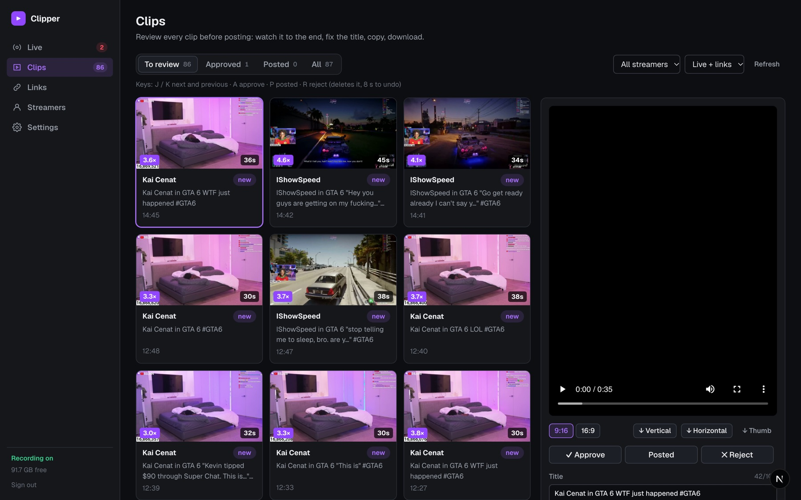
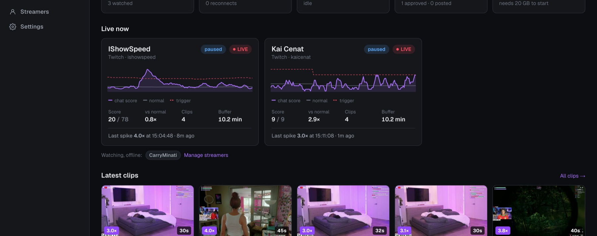
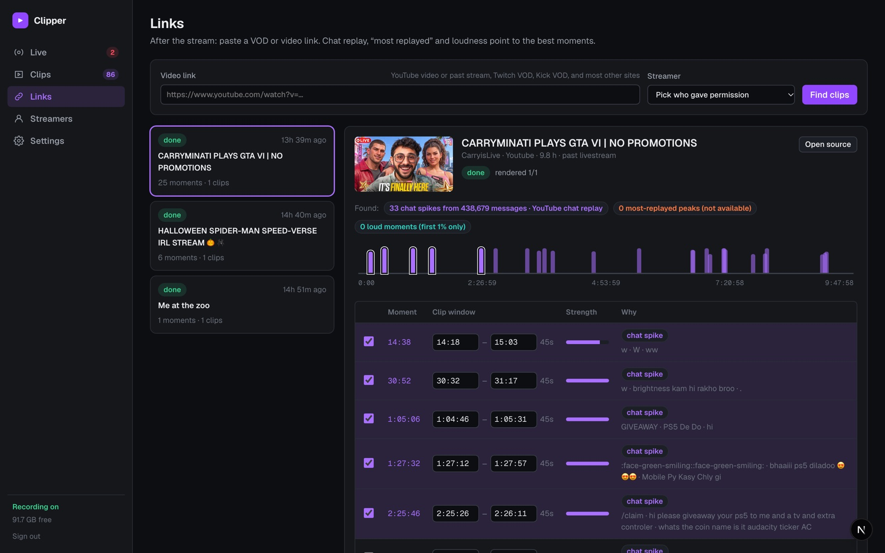
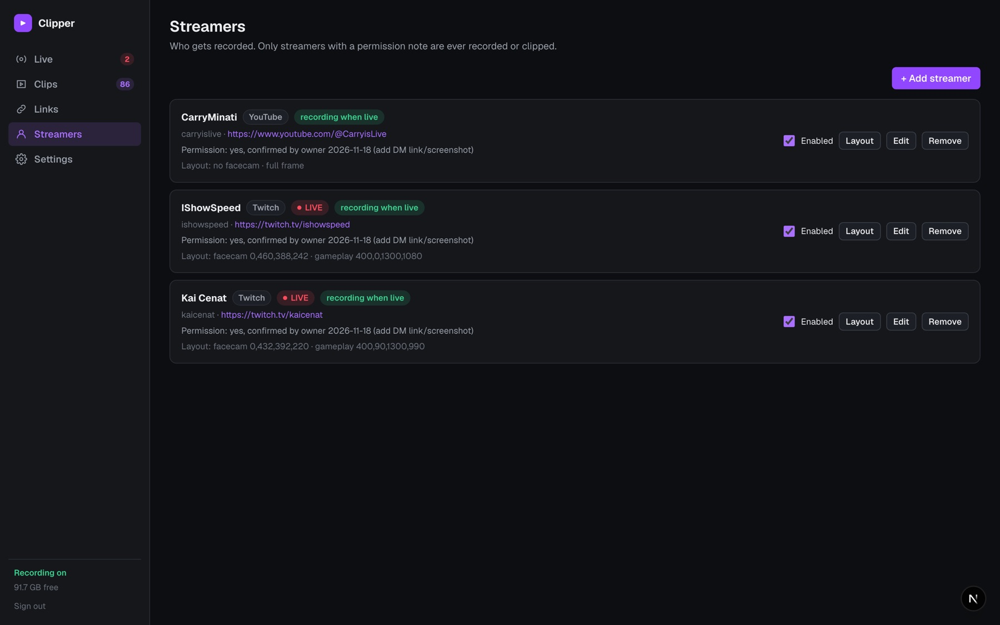
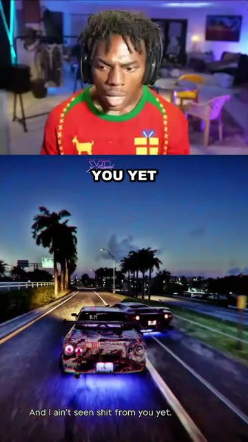
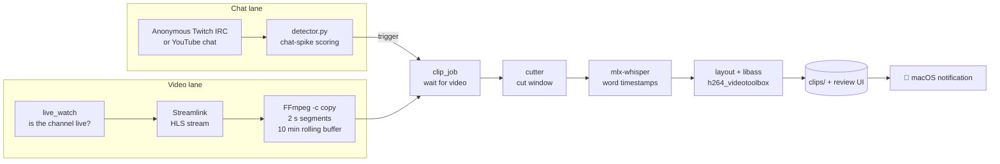
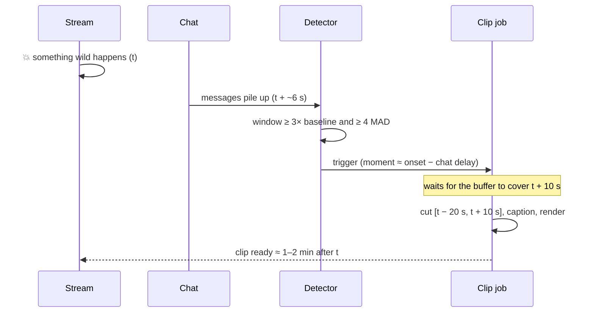

<div align="center">

# ⚡ RapidSnip

**Live stream in, captioned vertical clips out, a couple of minutes after the moment happens.**

RapidSnip watches Twitch and YouTube streams as they happen, uses chat as a highlight detector, and renders captioned 9:16 clips into a review queue on your Mac.


[Screenshots](#-a-look-around) · [How it works](#-how-it-works) · [Quick start](#-quick-start) · [Configuration](#%EF%B8%8F-configuration) · [Tools](#-tools) · [FAQ](#-faq)



</div>

---

## 🎯 Why

Most clippers wait for a stream to end, then search hours of video. RapidSnip works **during** the stream: when chat explodes, the clip is already being cut. The target is a finished, captioned vertical clip in the review queue **within 2 minutes** of the moment.

| | Typical clipping SaaS | RapidSnip |
|---|---|---|
| Watches live streams | ❌ | ✅ |
| Reads chat to find moments | ❌ | ✅ |
| Cost | Per minute processed | Free, runs locally |
| Captions | Cloud | Whisper on the Apple GPU |
| Posting | Often automatic | **A human reviews every clip** |

---

## 📸 A look around

<table>
<tr>
<td width="50%"><b>Live</b>: who's recording, chat score vs. normal, latest clips<br></td>
<td width="50%"><b>Clips</b>: review queue with keyboard shortcuts, approve / posted / reject<br></td>
</tr>
<tr>
<td><b>Links</b>: paste a VOD and get moments from chat replay, "most replayed" and loudness<br></td>
<td><b>Streamers</b>: only channels with a permission note are ever recorded<br></td>
</tr>
</table>

<details>
<summary><b>🎬 What a finished clip looks like</b> (click to expand)</summary>
<br>
<p align="center">
<br>
<sub>1080×1920: facecam on top, gameplay below, word-by-word captions burned in. A 16:9 version and a thumbnail are rendered too.</sub>
</p>
</details>

---

## 🧠 How it works

Two lanes run side by side for every live channel. Video goes into a cheap rolling buffer, and chat goes into the detector. When the detector fires, the matching seconds are pulled out of the buffer and rendered.



Everything to the left of `clip_job` runs continuously and costs almost no CPU, because FFmpeg copies the stream without re-encoding. The heavy work (cutting, Whisper, rendering) happens only for triggered moments, one clip at a time.

<details>
<summary><b>📈 How the detector decides a moment is clip-worthy</b></summary>

<br>

Chat lags the video by a few seconds, so a spike in chat points back at something that just happened on stream.

1. Messages are scored in **10-second windows**, recalculated every **2 seconds**. Reaction messages (`LUL`, `KEKW`, `💀`, `NO WAY`, `CLIP IT`, …) count extra, and known bots are ignored.
2. Each channel has its own **baseline**: the median score over the last 5 minutes, plus its MAD (median absolute deviation).
3. A window **triggers** only when all of these hold:
   - score ≥ **3×** the baseline
   - score ≥ baseline + **4 × MAD**
   - at least **8 unique chatters**
   - outside the warm-up (3 min after going live) and the cooldown (60 s)
4. The detector looks back up to 30 s for the **onset**, the first bin where chat started climbing, and subtracts the chat delay to estimate the real moment.
5. Spikes less than 15 s apart are **merged** into one clip, capped at 45 s.
6. Raids, hype trains and sub bombs **pause** detection for 90 s so they don't produce junk clips.



`detector.py` is pure logic: no sockets, files or clocks. The same code runs live and offline in `tools/replay.py`, so thresholds can be tuned against saved chat logs.

</details>

<details>
<summary><b>🔗 Link clipper (VODs and past streams)</b></summary>

<br>

Paste a YouTube video, a Twitch or Kick VOD, or most other video links. RapidSnip combines three signals:

- **Chat replay**: the same spike detection, run over saved chat
- **"Most replayed"** peaks from YouTube's heatmap, when available
- **Loudness** peaks in the audio (muted audio is ignored)

Analysis runs in an isolated process. You can tick, untick and adjust each clip window before rendering.

</details>

---

## 🚀 Quick start

> **Requirements:** an Apple Silicon Mac (M1 or newer), at least 20 GB of free disk, and [Homebrew](https://brew.sh).

```bash
# 1. Tools
brew install ffmpeg uv node

# 2. Python deps (the Whisper model, about 1.6 GB, downloads on first run)
uv sync

# 3. Web UI deps
cd web && npm install && cd ..
```

Then start the two halves in two terminals:

```bash
# Terminal 1: API + live recording (keeps the Mac awake while running)
uv run python -m clipper serve

# Terminal 2: web UI
cd web && npm run dev
```

Open **http://localhost:3210**.

<details>
<summary><b>Other ways to run it</b></summary>

<br>

| Command | What it does |
|---|---|
| `uv run python -m clipper` | Console only: records and clips, with a live `rich` status table |
| `uv run python -m clipper serve` | API on `:8000` with live recording |
| `uv run python -m clipper serve --no-live` | API only: review clips and use the link clipper, no recording |
| `uv run python -m clipper serve --host 0.0.0.0` | Reach the UI from other devices on your Wi-Fi |
| `uv run python -m clipper serve --remote` | Requires the shared key in `data/api_key`, for a hosted UI reached through a tunnel |

</details>

<details>
<summary><b>📱 Get every clip on your phone (Telegram)</b></summary>

<br>

Each new clip arrives in a private Telegram chat as a video you can save to Photos in one tap. The title and description are in tap-to-copy blocks, and **Approve / Posted / Reject** buttons update the app on the Mac. A reject from the phone gets the same 8-second undo.

1. In Telegram, message **@BotFather**, send `/newbot`, and copy the token it gives you.
2. Pair your phone:
   ```bash
   uv run python -m clipper telegram --token <token>
   ```
   Open the link it prints and press **Start**. A running `clipper serve` picks up the pairing within 10 seconds.

Clips over Telegram's 50 MB bot limit are sent as a slightly smaller copy (~38 MB, same 1080×1920). The token stays in `data/telegram.json`, which is git-ignored, and only your chat can press the buttons.

</details>

---

## ⚙️ Configuration

Everything lives in [`config.yaml`](config.yaml). Streamers can also be managed from the **Streamers** page.

```yaml
channels:
  - name: ishowspeed                 # Twitch login
    display_name: IShowSpeed
    permission: "yes, confirmed by owner 2026-11-18"   # required, or the channel is never recorded
    credit_url: https://twitch.tv/ishowspeed           # written into every clip's meta.json
    layout:                          # [x, y, w, h] in 1920×1080 pixels
      facecam: [0, 460, 388, 242]
      gameplay: [400, 0, 1300, 1080]
```

<details>
<summary><b>All the knobs</b></summary>

<br>

| Section | Key | Default | Meaning |
|---|---|---|---|
| — | `buffer_minutes` | `10` | Recent video kept on disk per channel |
| — | `min_free_gb` | `20` | Refuse to start below this |
| `detector` | `window_seconds` / `step_seconds` | `10` / `2` | Sliding chat window |
| `detector` | `ratio_threshold` | `3.0` | Score must be ≥ this × baseline |
| `detector` | `z_threshold` | `4.0` | …and ≥ baseline + this × MAD |
| `detector` | `min_unique_chatters` | `8` | Stops one spammer from triggering |
| `detector` | `cooldown_seconds` | `60` | Gap between separate clips |
| `detector` | `reactions` | `LUL, KEKW, 💀, …` | Messages that count extra |
| `clip` | `pre_seconds` / `post_seconds` | `20` / `10` | Clip window around the moment |
| `clip` | `chat_delay_seconds` | `6` | How far chat lags video (per channel) |
| `clip` | `max_length_seconds` | `45` | Hard cap |
| `clip` | `merge_gap_seconds` | `15` | Spikes this close become one clip |
| `captions` | `words_per_caption` | `3` | Caption chunk size |
| `layout` | `output` | `[1080, 1920]` | Vertical output size |

`ratio_threshold` and `chat_delay_seconds` can be overridden per channel.

</details>

---

## 🧰 Tools

| Tool | Use it to |
|---|---|
| `tools/calibrate.py <channel> [--preview]` | Grab a frame with a pixel grid to set facecam and gameplay crop boxes. You can also set them by dragging in the **Layout** editor on the Streamers page. |
| `tools/replay.py data/chat/<ch>/<day>.jsonl [--ratio 3.5]` | Run the detector over saved chat and see which triggers would fire. Change one setting at a time. |
| `tools/test_live.py` | Record 5 minutes of any live channel to smoke-test the pipeline |
| `uv run pytest` | Detector, chat, recorder, captions and link tests |

---

## 🗂️ Project layout

<details>
<summary><b>Show the tree</b></summary>

```
clipper/
  __main__.py      entry point: CLI or `serve`
  live_watch.py    is the channel live? (Streamlink)
  recorder.py      rolling mpegts buffer via FFmpeg -c copy
  chat.py          anonymous Twitch IRC
  youtube_chat.py  YouTube live chat
  detector.py      chat-spike detection (pure logic)
  clip_job.py      waits for the buffer, then cuts and renders
  cutter.py        FFmpeg cutting
  captions.py      word-timed .ass captions
  worker.py        single process holding the Whisper model
  layout.py        facecam + gameplay → 9:16
  links.py         VOD / link clipper (isolated process)
  server.py        FastAPI for the web UI
  db.py            SQLite index of clips and streamers
  output.py        clips/index.html + meta.json
  notify.py        macOS notifications
web/               Next.js UI (Live, Clips, Links, Streamers, Settings)
tools/             calibrate, replay, smoke tests
tests/             pytest
clips/             finished clips, one folder per day (git-ignored)
data/              buffer segments, chat logs, database (git-ignored)
```

</details>

Each clip folder contains `vertical.mp4`, `horizontal.mp4`, `thumb.jpg`, captions, and a `meta.json` with the title, description, chat stats and `credit_url`.

---

## 🛡️ Ground rules

- **Permission first.** A channel without a non-empty `permission` note is never recorded or clipped.
- **Always credit.** Every `meta.json` and description carries the streamer's `credit_url`.
- **Nothing is posted automatically.** The output is a folder of clips plus a review UI (and, if you pair it, your private Telegram), and a human approves every post.
- **Rejecting is final.** A rejected clip is deleted from disk after an 8-second undo window. Its chat stats are kept in `data/rejected.jsonl` for tuning.

---

## ❓ FAQ

<details>
<summary><b>Does it need a Twitch account or API key?</b></summary>
<br>No. Twitch chat is read anonymously over IRC (<code>justinfan…</code>), and Streamlink pulls the public stream.
</details>

<details>
<summary><b>Will it work on an Intel Mac or Linux?</b></summary>
<br>It's built for Apple Silicon: captions use MLX and encoding uses VideoToolbox. Swapping in <code>faster-whisper</code> and <code>libx264</code> would work but isn't wired up.
</details>

<details>
<summary><b>How much disk does it use?</b></summary>
<br>About 10 minutes of 1080p60 per live channel in the rolling buffer, plus finished clips. It refuses to start below 20 GB free.
</details>

<details>
<summary><b>Too many / too few clips?</b></summary>
<br>Save a chat log, run <code>tools/replay.py</code> on it, and adjust <code>ratio_threshold</code>, <code>z_threshold</code> or <code>min_unique_chatters</code> one at a time. Per-channel overrides go in <code>config.yaml</code>.
</details>

<details>
<summary><b>Where's the full spec?</b></summary>
<br><a href="PLAN.md"><code>PLAN.md</code></a> has the build plan and module specs. <a href="DECISIONS.md"><code>DECISIONS.md</code></a> logs every choice made along the way.
</details>

---

<div align="center">
<sub>Built for GTA 6 launch week, November 2026. Being live is the edge.</sub>
</div>
